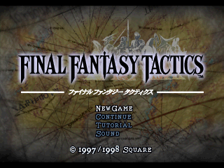
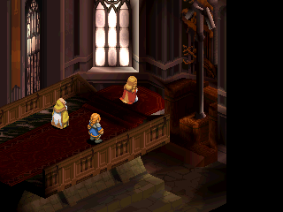
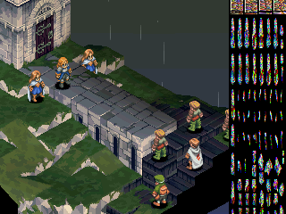
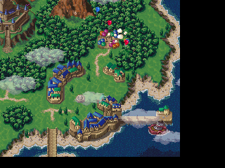
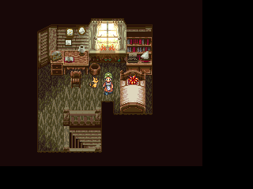
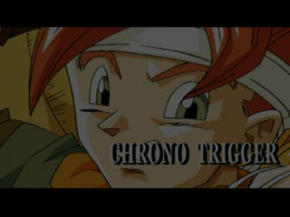

# JonBoy

[](https://github.com/OrangeTide/jonboy-psx/actions/workflows/ci.yml)

A PlayStation 1 (R3000A) emulator in C, rendered with SDL3. It boots the retail
BIOS and runs games from a disc image, with software GPU rasterization, SPU audio,
a DualShock controller, and memory cards. It also has an invented PSIO-style
SD-card cartridge and an in-emulation loader menu for booting PS-EXE and disc
images.

## Screenshots

Final Fantasy Tactics, booted from the retail BIOS off a mounted disc, reaching
its first tactical battle under scripted input:

| Title | Orbonne intro | Tutorial battle |
|-------|---------------|-----------------|
|  |  |  |

Chrono Trigger:

| Overworld | Bedroom |
|-----------|---------|
|  |  |

Its intro, decoded through the MDEC full-motion-video path:

| Opening | Title | Closing |
|---------|-------|---------|
|  |  |  |

Working so far:

- R3000A interpreter (the full CPU conformance suite passes) with the GTE.
- Software GPU: flat and textured polygons, rectangles, and VRAM transfers. In the
  windowed build its rasterization runs on a dedicated worker thread by default, in
  parallel with the emulation thread.
- SPU audio: 24 ADPCM voices with ADSR, reverb, noise, pitch modulation, and
  volume sweeps, plus CD-DA and XA-ADPCM streaming.
- CD-ROM: mounts `.bin`/`.cue`/`.iso`, boots real games through the retail BIOS.
- Controllers: a DualShock (digital and analog) driven by the keyboard or an SDL
  gamepad, and memory cards backed by a raw 128 KB image.

## Building

The windowed emulator uses SDL3. On Linux, install SDL3 and its
`pkg-config` file, then build:

```
make
```

`make` produces:

- `_out/jonboy`, the emulator.
- `_out/test1.cart` and `_out/test2.cart`, the CPU self-tests (see below).

### Test toolchain

The self-test carts are assembled from MIPS assembly, so building them needs a
`mipsel-unknown-elf` binutils toolchain (`as`, `ld`, `objcopy`). If that
toolchain is absent, `make _out/jonboy` still builds the emulator on its own.

### macOS app bundle

On macOS, `make macos-app` packages `_out/JonBoy.app`, a self-contained bundle
with the SDL3 library copied in, so it runs on a Mac without Homebrew. The build
is not code-signed, so the first launch is blocked by Gatekeeper. Clear the
download quarantine once to run it:

```
xattr -dr com.apple.quarantine /path/to/JonBoy.app
```

CI builds this bundle for Apple Silicon on every run and uploads it as an
artifact.

### Installing

`make install` copies the emulator and its man page under `PREFIX`, which
defaults to `$HOME/.local` (the XDG user prefix, no root needed):

```
make install                 # into ~/.local
make install PREFIX=/usr/local   # system-wide
```

`DESTDIR` stages into a packaging root, and `make uninstall` removes both files.

## Running

```
./_out/jonboy
```

This opens the SDL window and starts the CPU at the BIOS reset vector
(`0xBFC00000`). Place a BIOS image named `bios.bin` in the working directory to
have it mapped and executed. Without one, the emulator still runs, against an
empty ROM. Press Escape or close the window to quit; F1 toggles between the
display area and the full 1024x512 VRAM view.

### Booting a game

Mount a disc image and boot it through a retail BIOS:

```
./_out/jonboy --bios /path/to/scph5501.bin --cd "/path/to/Game.cue"
```

`--cd` accepts a `.bin`, `.cue` (including multi-track), or `.iso`. Add
`--memcard card.mcr` to attach a memory card (a raw 128 KB image, created and
formatted if the file does not exist), so the BIOS shell and games can save.
`--memcard2 card2.mcr` attaches a second card in the other controller port.

The windowed emulator runs the console on a separate thread from the window, so
input, video, and audio stay responsive even when emulation stalls, and a disc
image on a slow or network filesystem is read ahead on a background thread rather
than freezing the display. GPU rasterization also runs on its own worker thread, so
the drawing work for heavy scenes happens in parallel with the rest of the core
rather than competing with it for the real-time frame budget; set
`JONBOY_GPU_THREAD=0` to fall back to inline rasterization. The picture is always
presented at the 4:3 format the console sends to a TV, independent of the game's
internal horizontal resolution. The window is locked to 4:3 so a resize keeps the
picture correct with no bars; fullscreen pillarboxes or letterboxes the 4:3 picture
inside the native display. The scaling filter (linear or nearest) is a separate
choice in the menu's View submenu. A disc swapped at runtime (see Scripted input)
raises the drive-cover interrupt, so a running game notices the change.

The headless, `--boot`, `--exe`, and `--gdb` modes keep a single-threaded,
deterministic core (no worker threads), so reference traces and conformance stay
bit-for-bit reproducible.

### Controls

The keyboard maps to the pad: arrow keys are the D-pad, `Z`/`X`/`A`/`S` are
Cross/Circle/Square/Triangle, `Enter`/`Right Shift` are Start/Select, `Q`/`W`/`E`/
`R` are L1/R1/L2/R2, `C`/`V` are L3/R3, and `Tab` toggles the DualShock analog
mode. If an SDL gamepad is connected it drives the buttons and both analog sticks.

### Loader menu

Point the emulator at a directory of games to browse and boot them from an
on-screen menu:

```
./_out/jonboy --games /path/to/games --bios /path/to/scph5501.bin
```

The menu lists PS-EXE files and disc images; move the cursor with the D-pad and
press Cross to boot the selection.

### Scripted input

`--script <file>` runs a timed system-event script, useful for demos and
automated captures. Each line is `<frame> <command> ...`, clocked by the video
frame counter:

```
0    pad none
120  pad right
150  pad right cross
300  disc eject
```

Commands are `pad <buttons/sticks>` (held until the next `pad` line), `analog
on|off`, and `disc <path>` / `disc eject`.

### Debugging with gdb

`--gdb [port]` boots the BIOS headless and waits for `mipsel-unknown-elf-gdb` to
connect over a loopback TCP socket (default port 1234). The CPU starts halted at
the reset vector, so you can set breakpoints and step:

```
./_out/jonboy --gdb --bios /path/to/scph5501.bin --cd "/path/to/Game.cue"
```

Then, from gdb:

```
mipsel-unknown-elf-gdb
(gdb) target remote 127.0.0.1:1234
(gdb) break *0x80030000
(gdb) continue
```

Registers, memory, breakpoints, watchpoints (`watch`/`rwatch`/`awatch`), single
step (`stepi`), continue, and Ctrl-C to interrupt all work. Load your program's
`.elf` with `file game.elf` first to get source-level symbols. The server listens
on loopback only.

## Testing

There are three layers of tests: small CPU self-tests that ship with the source,
host unit tests for the individual subsystems, and an external CPU conformance
suite run against third-party test ROMs.

### Headless modes

The emulator runs without a window for testing. Two modes are available:

- `--headless <file>` loads a flat binary into RAM and runs it. Options:
  `--load-addr <hex>` (physical load address, default 0), `--pc <hex>` (entry
  point, default the load address), and `--steps <n>` (instruction budget).
  When it stops it prints all registers, `$s0`, and a memory window.

- `--exe <file.exe>` loads and runs a PlayStation executable (PS-EXE). It reads
  the entry PC, GP, and SP from the header. Options: `--steps <n>` and
  `--vram-out <file>` to write the visible 320x240 framebuffer region as a PPM
  image.

### Self-tests

Two hand-written tests live in the source tree and assemble into cart images.
Both use the `BREAK` instruction as a monitor trap: under `--headless` it stops
the CPU and the harness reports `$s0`. Success is `$s0 == 0xDEADBEEF`.

- `test1.asm` covers register and immediate arithmetic, sign extension, logical
  and shift operations, and the branch and load delay slots. It is assembled
  with `.set noreorder` so the delay slots are exactly as written.

- `test2.asm` covers the exception path. It installs a handler at the general
  exception vector (`0x80000080`), triggers arithmetic overflow, a syscall, and
  an unaligned load, then checks that each vectored correctly, left its
  destination register untouched, and returned through `RFE`.

Run them:

```
./_out/jonboy --headless _out/test1.cart --steps 3000
./_out/jonboy --headless _out/test2.cart --steps 3000
```

Each should end with `RESULT $s0 = 0xDEADBEEF`.

### Subsystem unit tests

Each device is also exercised by a host unit test that compiles the subsystem on
its own with stub globals, so they build and run without SDL or a BIOS:

```
make cdda-test spu-test xa-test mc-test loader-test pad-test script-test
```

They cover CD-DA playback, the SPU mixer (voices, reverb, noise, pitch, sweeps,
CD-to-reverb, and the sound-RAM IRQ), XA-ADPCM decoding, the memory card, the
loader game index, the digital and DualShock controllers, and the system-event
script. The default `make` builds them all.

### CPU conformance suite

The CPU instruction set is validated against Peter Lemon's per-opcode PSX CPU
tests. Each test is a bare-metal PS-EXE that computes results and draws a green
`PASS` or red `FAIL` glyph per subtest into VRAM. The `--exe` runner reads the
verdict back by sampling the color of the result column, so no display is
needed.

These reference ROMs are not part of this repository. Place them under `REF/`,
keeping their original layout, so the tests are found at
`REF/PSX/CPUTest/CPU/<OP>/*.exe`. The `REF/` directory is ignored by git.

Run one test and save its rendered framebuffer:

```
./_out/jonboy --exe REF/PSX/CPUTest/CPU/ADD/CPUADD.exe --vram-out add.ppm
```

Run the whole suite and get a pass/fail tally:

```
make conformance
```

All 29 opcode tests currently pass. This covers ADD, ADDI, ADDIU, ADDU, AND,
ANDI, DIV, DIVU, MULT, MULTU, NOR, OR, ORI, SUB, SUBU, XOR, XORI, the shifts
(SLL, SLLV, SRA, SRAV, SRL, SRLV), and the loads and stores (LB, LH, LW, SB,
SH, SW).

These reference ROMs are third-party and are not part of this repository.
